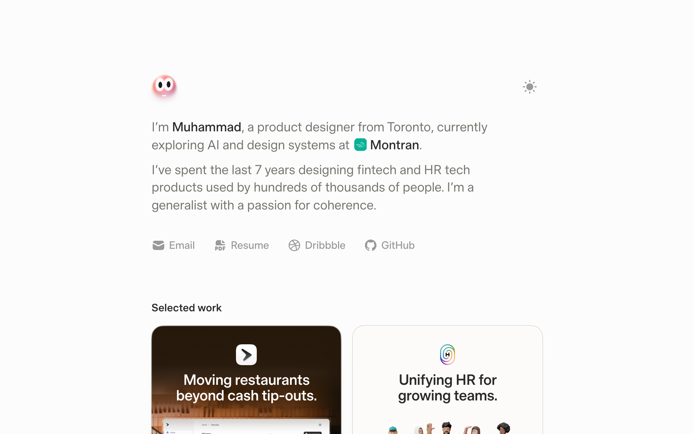

<picture>
  <source media="(prefers-color-scheme: dark)" srcset=".github/assets/preview-dark.png">
  
</picture>

# Portfolio

I'm Muhammad, a product designer from Toronto, and this is the code for my
portfolio. I built it with AI. If you've already clicked around the site, here are
a few small things you might have missed.

There's a little character at the top of the homepage. It doesn't do anything
useful, I just like that the page notices you. It watches your cursor. Spin around
it and it gets dizzy. Click somewhere empty and it looks over, puzzled. Pet it and
it warms up to you. Ignore it and it gets bored and falls asleep. It's in your
browser tab too: switch away and it dozes off, come back and it says hello.
([code](src/components/home/character))

The note in the footer tells you when I'll actually reply, based on the time in
Toronto. At 3am it says I'm probably asleep. On a Saturday it says I'm back Monday.
([code](src/components/home/footer/toronto-time.ts))

The experience list shows whether a role was full-time or a contract, because
that's the first thing you wonder when you see a short stint on a resume.
([code](src/content/experience.ts))

Each case study card gets its color from its own image, so the gradient melts into
the picture. ([code](scripts/extract-card-colors.ts))

Opening a case study took four tries. I built a card morph, then a diagonal wipe,
then a logo handoff, and they all felt slow, especially in Safari. Now it's just a
quick zoom. ([code](src/components/motion/page-wipe.ts)) Other things I tried and
compared are in the [lab](src/components/lab).

## Working with AI

[`AGENTS.md`](AGENTS.md) is the brief I give the agents. I check everything in the
browser and point out what to fix with a tool called Agentation.

To run it yourself, see [`docs/maintaining.md`](docs/maintaining.md). The code is
MIT licensed. My writing and media aren't, see [LICENSE](LICENSE).
