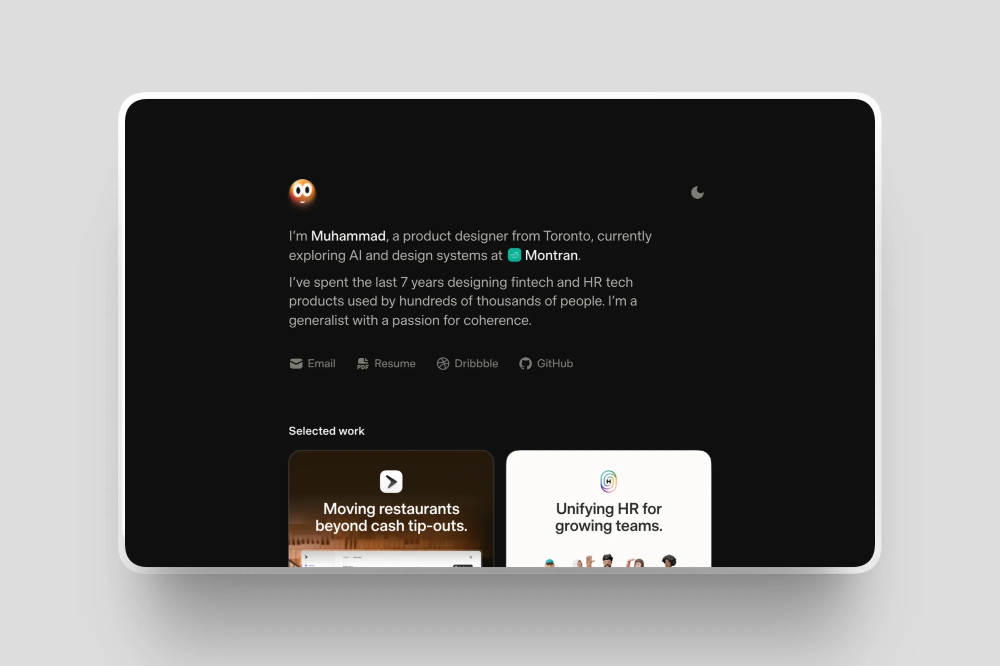

<br>

This is my personal portfolio website, built with Next.js, React, and Motion. It's where I
share my experience, case studies, and recent work.

## Features

### Avatar

My avatar is the site's logo and its loading state.

- **[Loading](src/components/home/character/background.tsx)**: It shows up first as bare
  glass while the page loads, shuffles through colors until it lands on one, then moves
  into place.
- **[Attention](src/components/home/character/director.ts)**: Its eyes follow your cursor.
  Tap it and it reacts. Ignore it and it finds something to do, like taking a nap.
- **[Chasing](src/components/home/character/grab.ts)**: Pull it and it springs back. Keep
  chasing it and it dodges a few times, runs out of breath, and lets you catch it.
- **[Dizziness](src/components/home/character/dizziness.ts)**: Circle your cursor around
  it or whip it back and forth, and its eyes get dizzy from following you.
- **[Glass](src/components/home/character/glass.ts)**: The highlights hold still, like
  they're lit from somewhere in the room, while the color sloshes around inside.

### Motion

- **[Case study transition](src/components/motion/page-wipe.ts)**: Opening a case study
  zooms in from its card. Real card morphs stuttered, mostly in Safari, so it uses one
  snapshot of the page with a light scale, blur, and fade, all in CSS.
- **[Line-by-line text](src/components/motion/case-study-line-ink.ts)**: Case study text
  fades in a line at a time as you scroll. The CSS Custom Highlight API paints each line
  without wrapping it in a span, so the text stays plain and can rewrap on any screen.
- **[Signature](src/components/home/footer/signature.tsx)**: My signature draws itself
  once the whole footer is on screen.
- **[Reply note](src/components/home/footer/reply-note.tsx)**: The footer says when to
  expect a reply based on the time in Toronto, with the clock rolling forward.
- **[Feed](src/components/home/playground/snap.ts)**: On desktop the cards respond to your
  pointer. On a phone, the card you've scrolled to takes over that job.

### Surfaces

- **[Progressive blur](src/components/ui/progressive-blur.tsx)**: Blurs fade in gradually,
  like on iOS. CSS gives an area one blur amount, so I stack layers, each masked to its
  own band and a little stronger than the last.
- **[iOS-style corners](src/components/ui/smooth-surface.tsx)**: Every surface uses the
  same smooth curve. Clipping to it also cuts off borders and shadows, so borders are drawn
  along the curve and shadows sit on the parent.

### Performance

- **[Videos](src/components/work/video-loop-clock.ts)**: Clips pause off screen and work
  out where they would have been when you come back, so nothing restarts.
- **[Video formats](src/components/ui/video-sources.tsx)**: Clips offer AV1 and HEVC where
  they exist, with H.264 as the fallback every browser can play.
- **[Images](next.config.ts)**: Everything is WebP. AVIF files are smaller, but Safari took
  longer to decode them than the smaller files saved.
- **[Corners](src/components/ui/smooth-surface.tsx)**: Surfaces more than a screen away
  keep plain CSS corners until they come near, so a page doesn't measure dozens at once.

### Accessibility

- **Reduced motion**: Animations respect the setting, and text that fades in falls back to
  plain static text.
- **[Keyboard](src/components/home/home-keyboard-focus.tsx)**: Tab moves through the
  homepage in order, even with Safari's limited Tab mode.


## Tech stack

- **Framework**: [Next.js](https://nextjs.org) and [React](https://react.dev), with
  TypeScript
- **Animation**: [Motion](https://motion.dev)
- **Corners**: [Lisse](https://www.npmjs.com/package/@lisse/react)
- **Rolling text**: [Scritto](https://scrit.to)
- **Handwritten notes**: [Drawesome](https://benji.org/drawesome)
- **Content**: MDX
- **Typeface**: Timeless Sans

## Project structure

```
src/
├── app/                 Routes, global styles, and fonts
├── components/
│   ├── home/            Avatar, dock, experience, feed, and footer
│   ├── motion/          Page transitions and scroll effects
│   ├── ui/              Blur, corners, and shared pieces
│   └── work/            Case studies
└── content/projects/    Case study writing and metadata
```

To run it, see [`docs/maintaining.md`](docs/maintaining.md).

## License

The code is MIT licensed. My writing and media aren't, see [LICENSE](LICENSE).
